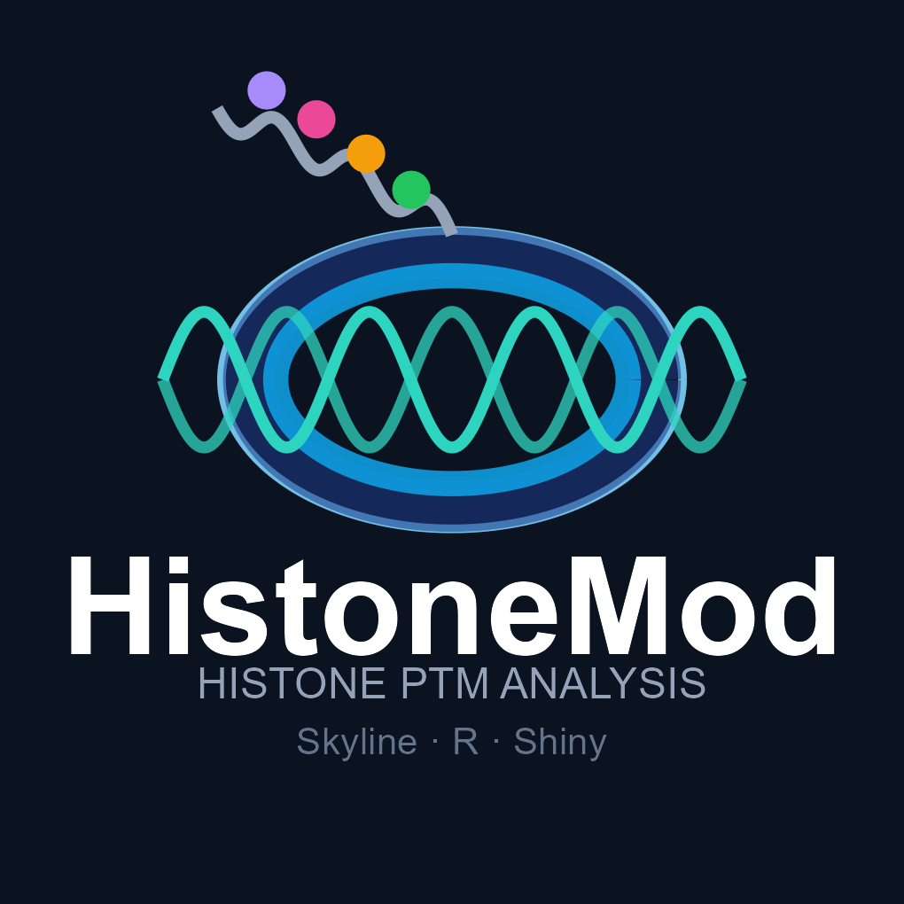
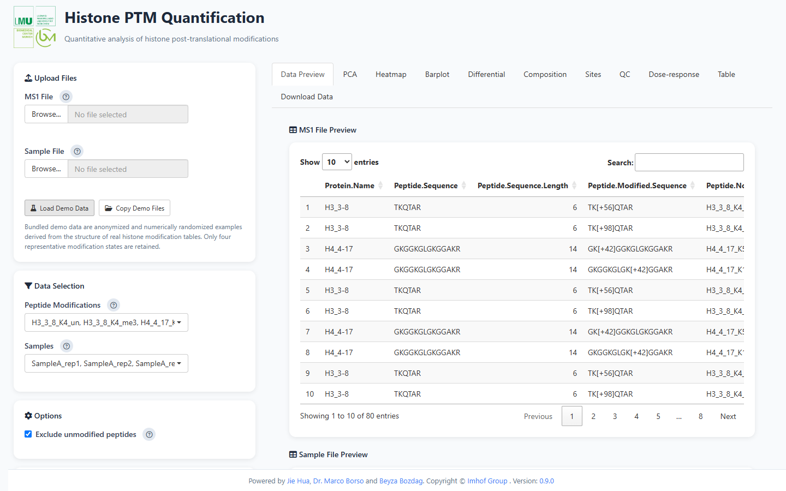
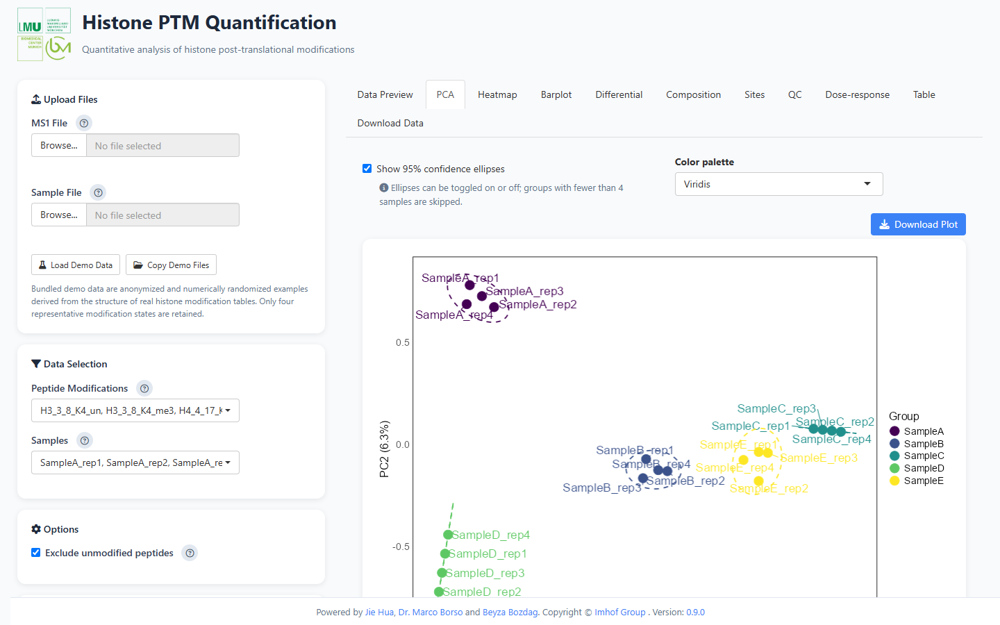
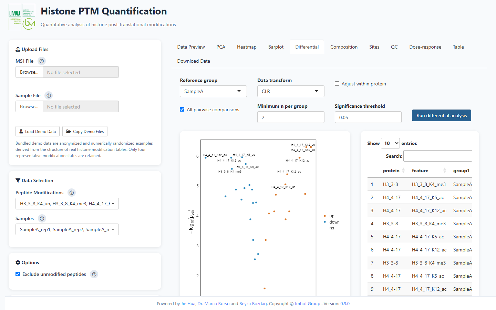
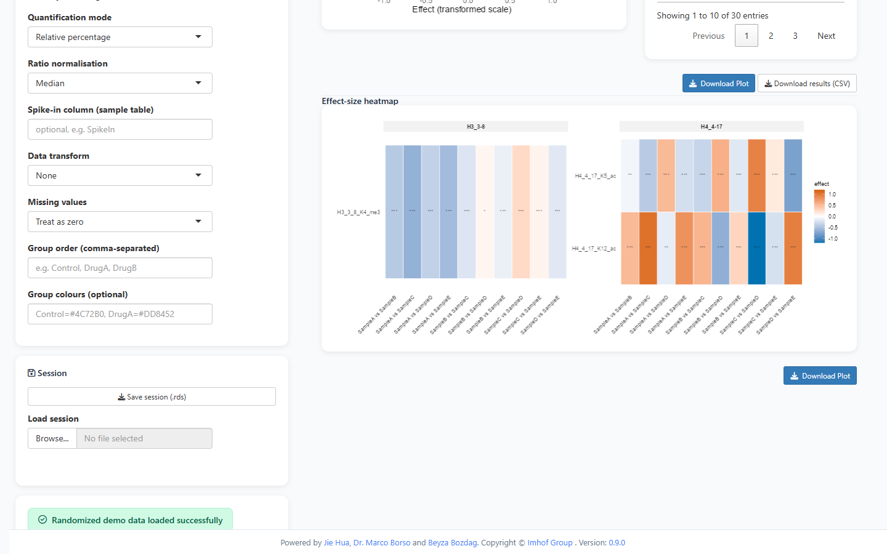
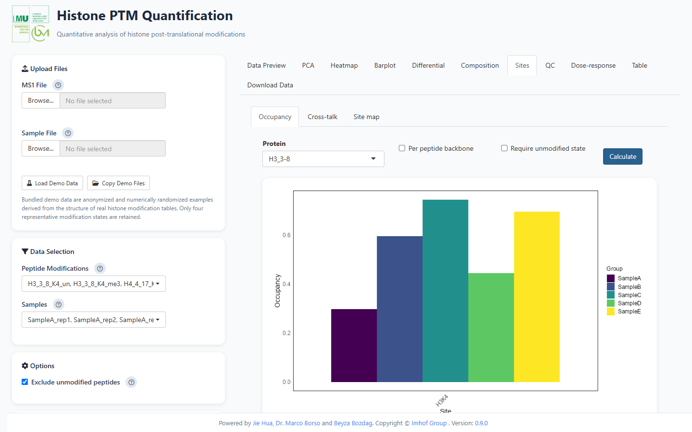
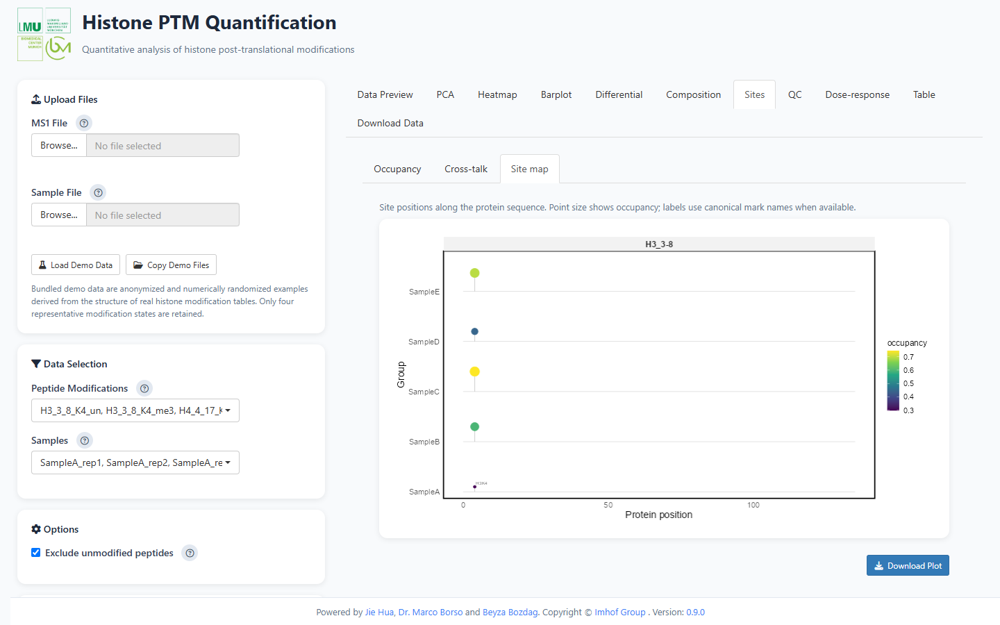
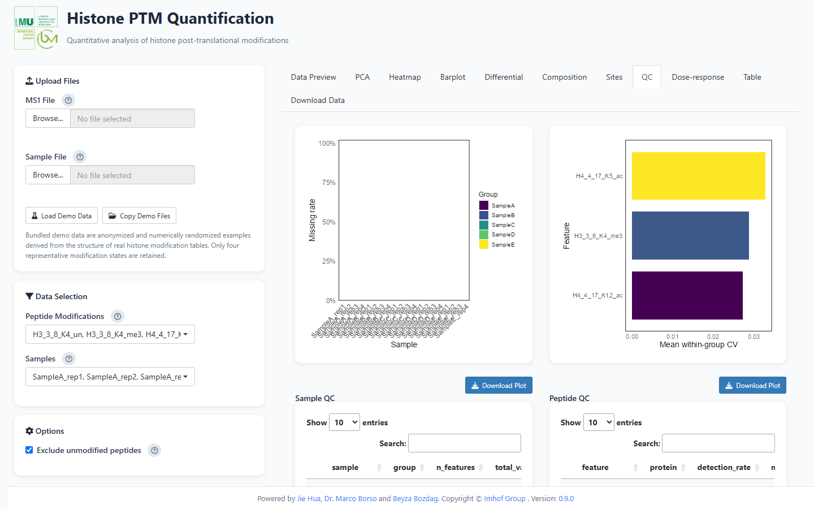
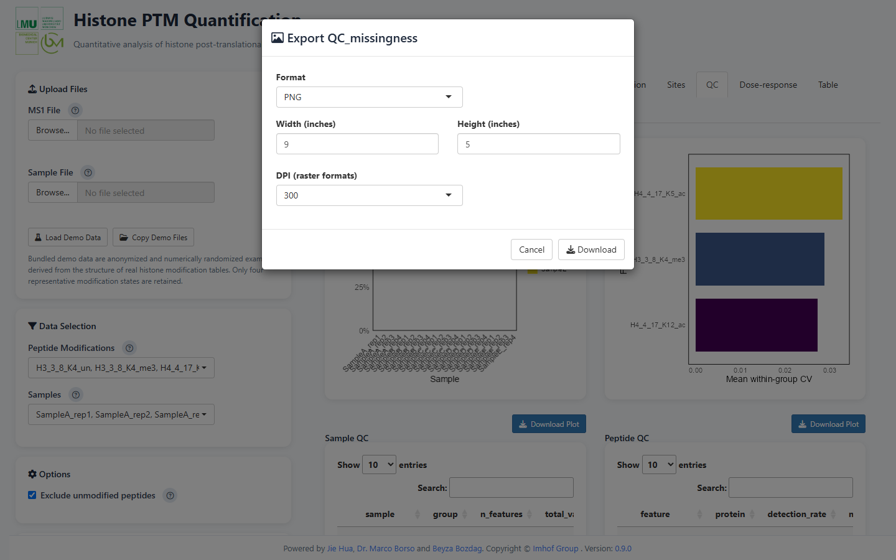

<div align="center">
  
  <h1>HistoneMod</h1>
  <p><strong>Interactive analysis and visualization of histone post-translational modifications from Skyline exports.</strong></p>
  <p>From Skyline CSV to publication-ready figures — locally, reproducibly, in R.</p>
  <p>
    <a href="https://jiehua1995.github.io/HistoneMod/"></a>
    <a href="https://doi.org/10.5281/zenodo.20831990"></a>
  </p>
  <p>
    
    
    
    <a href="LICENSE"></a>
  </p>
  <p>
    <a href="#installation">Installation</a> ·
    <a href="#quick-start">Quick start</a> ·
    <a href="#screenshots">Screenshots</a> ·
    <a href="#input-data">Input data</a> ·
    <a href="#programmatic-api">API</a> ·
    <a href="#citation">Citation</a>
  </p>
</div>

---

## Why HistoneMod

Bottom-up histone PTM experiments produce a very specific kind of data: many
peptide states, overlapping modification sites, small replicate numbers, and a
mixture of relative abundances and occupancies. HistoneMod is built around that
data model rather than around generic proteomics plots.

- **Skyline-first**: reads standard Skyline MS1 exports directly, with automatic
  delimiter detection and column mapping when a report uses different names.
- **Histone-aware**: parses Unimod IDs and `Peptide Note` conventions into
  residue-level sites, estimates site occupancy, analyses combinatorial
  cross-talk, and annotates sites with a curated histone mark table.
- **Publication-oriented**: site maps, effect-size heatmaps, PCA diagnostics,
  volcano plots, composition and QC views — all exportable as PNG, PDF, SVG,
  TIFF, EPS or JPEG.
- **Reproducible**: session/project files, reproducible analysis bundles,
  methods text, figure legends, and a quick PDF report.

## Features

| Area | What you get |
| --- | --- |
| **Data import** | Skyline MS1 + sample CSVs, delimiter/BOM detection, column mapping, structured validation, large-file support |
| **Quantification** | Relative percentages, light/heavy ratios, spike-in normalization, per-protein/per-replicate summaries |
| **Compositional analysis** | CLR, ALR, logit and log2 transforms with explicit zero handling |
| **Differential analysis** | Welch tests, all pairwise comparisons, BH correction, effect sizes, volcano plots, effect-size heatmaps |
| **Site-level analysis** | Unimod/`Peptide Note` parsing, site occupancy per backbone, site maps, combinatorial cross-talk |
| **Annotation** | Curated histone mark table: canonical names, active/repressive classes, writers, erasers, readers |
| **Quality control** | Missingness, CV, retention-time consistency, sample correlation and outlier views |
| **Dose / time / power** | 4PL dose-response (EC50), exponential time-course (half-life), simulation-based power analysis |
| **Batch and comparison** | Batch processing of multiple Skyline exports and two-experiment effect comparison |
| **Reporting** | PDF report with Methods and Statistics pages, methods text, figure legends, project bundles |

## Installation

HistoneMod requires **R ≥ 4.1**. Install it from GitHub with dependencies:

```r
install.packages("remotes")
remotes::install_github("jiehua1995/HistoneMod")
```

To follow the development version:

```r
remotes::install_github("jiehua1995/HistoneMod", ref = "dev")
```

If you already cloned the repository:

```r
remotes::install_local("HistoneMod", dependencies = TRUE)
```

Dependencies are declared in `DESCRIPTION` and installed automatically. The
package uses a local Shiny application; no server or account is required.

## Quick start

Launch the application from R:

```r
library(HistoneMod)
runHistoneMod()
```

Then:

1. **Upload** your Skyline `MS1` CSV and sample annotation CSV in the sidebar, or
   click **Load Demo Data** to try the bundled randomized demo dataset.
2. If a required column is missing, a **column mapping** dialog appears; choose
   the matching column for each field.
3. Select peptides and samples, choose whether to exclude unmodified peptides,
   and adjust the analysis settings (quantification mode, transform, missing
   values, group order and colours).
4. Explore the tabs — **PCA**, **Heatmap**, **Barplot**, **Differential**,
   **Composition**, **Sites**, **QC**, **Dose-response**, **Table**.
5. Export any figure with **Download Plot**, or use **Download Data** for the
   wide table, project file, methods text and the quick PDF report.

A programmatic workflow is also available:

```r
library(HistoneMod)

ms1 <- read_skyline_csv("MS1.csv")
sample <- read_skyline_csv("samples.csv")

data <- percentage_calculation(ms1, sample)
plot_pca(data, transform = "clr")
plot_heatmap(data, scale = "row")

res <- differential_analysis(data, transform = "clr")
plot_volcano(res)
plot_effect_heatmap(res)
```

## Screenshots

### 1. Load and inspect your data

Upload both CSV files, or load the bundled demo data. The preview shows the MS1
table and the sample annotation table before analysis.

<p align="center">
  
</p>

### 2. Explore the structure with PCA

PCA scores with 95% confidence ellipses, configurable palettes, and optional
scree and loadings diagnostics.

<p align="center">
  
</p>

### 3. Test group differences

Choose a reference group or compare all pairs, select the transform and minimum
group size, then inspect the volcano plot and the result table.

<p align="center">
  
</p>

The effect-size heatmap summarises all comparisons in one figure, with
significance stars and clustered rows.

<p align="center">
  
</p>

### 4. Work at the site level

Occupancy is estimated per modification site and group, with optional
backbone-level detail.

<p align="center">
  
</p>

The site map places each modified residue along the protein sequence, showing
occupancy (or group effect) and canonical mark labels.

<p align="center">
  
</p>

### 5. Check data quality

Missingness, within-group CV, sample correlation, missingness tiles and
retention-time drift are available in the QC tab.

<p align="center">
  
</p>

### 6. Export publication-ready figures

Every analysis figure can be exported with format, width, height and DPI
controls.

<p align="center">
  
</p>

## What you can adjust in the app

| Setting | Options |
| --- | --- |
| Quantification mode | Relative percentage · light/heavy ratio · spike-in ratio |
| Ratio normalization | Median · sum · none |
| Spike-in column | any numeric column in the sample table |
| Data transform | None · CLR · logit · log2 |
| Missing values | Treat as zero · half minimum · drop incomplete |
| Group order | comma-separated order, e.g. `Control, DrugA, DrugB` |
| Group colours | named colours, e.g. `Control=#4C72B0, DrugA=#DD8452` |
| PCA | ellipses on/off · palette · scree · loadings |
| Heatmap | row/column clustering · palette · row z-score · group/protein/mark-class annotation · protein gaps |
| Differential | reference group · all pairwise · transform · minimum n · significance threshold · within-protein adjustment |
| Barplot | significance stars · error bars (SE/SD/95% CI) · n labels · manual Y range |
| Dose-response | dose column · number of features |
| QC | missingness · CV · sample correlation · missingness map · RT consistency |
| Export | PNG · PDF · SVG · JPEG · TIFF · EPS · BMP · width · height · DPI |

## Input data

HistoneMod expects two comma-separated CSV files. Column names containing spaces
are converted to dotted names after import (for example, `Protein Name` becomes
`Protein.Name`).

### MS1 table

| Protein Name | Peptide Note | Replicate Name | Total Area MS1 | Isotope Label Type |
| --- | --- | --- | ---: | --- |
| H3_3-8 | H3_3_8_K4_un | SampleA_rep1 | 4320000000 | light |
| H3_3-8 | H3_3_8_K4_me3 | SampleA_rep1 | 1680000000 | light |

Required columns: `Protein.Name`, `Peptide.Note`, `Replicate.Name`,
`Total.Area.MS1`, `Isotope.Label.Type`. Optional Skyline columns such as
`Peptide.Modified.Sequence.Unimod.Ids`, `Peptide.Retention.Time`,
`Peptide.Start`, `Peptide.End`, `Precursor.Charge` and
`RatioLightToHeavy` are used when present.

### Sample table

| Replicate Name | Group | Replicate No |
| --- | --- | --- |
| SampleA_rep1 | SampleA | 1 |
| SampleA_rep2 | SampleA | 2 |

Required columns: `Replicate.Name`, `Group`, `Replicate.No`. Numeric columns
such as `Dose`, `Time` or `Batch` are carried through and can be used by the
dose-response, time-course or batch analyses.

### Skyline export

In Skyline, use **File → Export → Report** and include the columns above. If
your report uses different column names, keep them as they are — the app will
ask you to map them after upload. Comma, semicolon and tab delimiters are
detected automatically, and UTF-8 BOMs are handled.

## Programmatic API

| Area | Functions |
| --- | --- |
| Import | `read_skyline_csv()`, `infer_sample_sheet()`, `map_columns()`, `validate_input_tables()` |
| Quantification | `percentage_calculation()`, `quantify_peptides()`, `normalize_values()` |
| Composition | `transform_composition()`, `composition_matrix()` |
| Differential | `differential_analysis()`, `plot_volcano()`, `plot_effect_heatmap()` |
| Sites | `parse_peptide_sites()`, `compute_site_occupancy()`, `plot_occupancy()`, `plot_site_map()`, `compute_crosstalk()`, `plot_crosstalk()` |
| Annotation | `histone_marks()`, `normalise_histone_protein()`, `annotate_sites()`, `summarise_by_class()`, `plot_mark_classes()` |
| QC | `qc_summary()`, `plot_qc_missingness()`, `plot_qc_cv()`, `plot_sample_correlation()`, `plot_missingness_tile()`, `plot_rt_consistency()` |
| Dose and time | `fit_dose_response()`, `plot_dose_response()`, `fit_time_course()`, `plot_time_course()` |
| Power | `simulate_histone_data()`, `estimate_power()`, `plot_power_curve()` |
| Batch and comparison | `run_histonemod_batch()`, `compare_experiments()`, `plot_experiment_comparison()` |
| Projects and reporting | `save_session()`, `load_session()`, `save_project()`, `load_project()`, `export_analysis_bundle()`, `methods_text()`, `statistics_table()`, `figure_legend()` |
| Styling | `theme_histonemod()`, `histonemod_palette()`, `scale_colour_histonemod()`, `scale_fill_histonemod()` |

## Documentation

- **Website / function reference**: <https://jiehua1995.github.io/HistoneMod/>
- **Bundled vignette**: `vignette("tutorial", package = "HistoneMod")`
- **Help pages**: `?runHistoneMod`, `?differential_analysis`,
  `?compute_site_occupancy`, `?histone_marks`

## Export and reporting

- Figures: PNG, PDF, SVG, JPEG, TIFF, EPS, BMP with configurable size and DPI.
- Tables: wide-format CSV and differential/occupancy/QC result tables.
- Project: `.rds` containing inputs, settings and results.
- Reproducible bundle: `export_analysis_bundle()` writes inputs, project file,
  settings, README and an `analysis.R` script.
- PDF report: cover, methods, data source, PCA, heatmap, statistics and
  paginated barplots.
- Text: `methods_text()`, `figure_legend()` and `statistics_table()` generate
  manuscript-ready content.

## Troubleshooting

**Installation fails on a fresh machine.**
Install `remotes` (or `pak`) first and make sure R is ≥ 4.1. A full install pulls
the Shiny/ggplot2 stack and may take several minutes.

**My Skyline report has different column names.**
Keep the file as exported; after upload, map the required columns in the dialog.
The mapping is stored for the current session.

**I use heavy/SILAC or spike-in samples.**
Set `Quantification mode` to `Light/heavy ratio` or `Spike-in ratio` in
`Analysis Settings`. The sample table needs a numeric spike-in column for
spike-in mode.

**Missing values are treated as zero.**
Change `Missing values` to `Half minimum` or `Drop incomplete` in
`Analysis Settings`.

**The app does not open.**
Run `options(shiny.launch.browser = TRUE)` before `runHistoneMod()`, or open the
printed local URL in your browser.

## Citation

If HistoneMod contributes to your research, please cite:

> Hua J, Borso M, Bozdag B, Imhof A (2026). *HistoneMod: Interactive Analysis of
> Histone Post-Translational Modifications.* R package v0.9.0. Zenodo.
> <https://doi.org/10.5281/zenodo.20831990>

```bibtex
@software{hua2026histonemod,
  author  = {Hua, Jie and Borso, Marco and Bozdag, Beyza and Imhof, Axel},
  title   = {HistoneMod: Interactive Analysis of Histone Post-Translational Modifications},
  year    = {2026},
  version = {0.9.0},
  doi     = {10.5281/zenodo.20831990},
  url     = {https://github.com/jiehua1995/HistoneMod}
}
```

## Contributing and support

- Bug reports and feature requests:
  <https://github.com/jiehua1995/HistoneMod/issues>
- Development happens on the `dev` branch; `main` is kept stable.
- Contributions are welcome. Please run `devtools::test()` and
  `R CMD check` before opening a pull request.

## Acknowledgements

Developed in the [Imhof Laboratory](https://www.molekularbiologie.abi.med.uni-muenchen.de/personen/imhof_group/index.html),
Biomedical Center Munich, Ludwig-Maximilians-Universität München.

<p>
  
</p>

## License

MIT License. See [LICENSE](LICENSE) and [LICENSE.md](LICENSE.md).

<div align="center">
  <sub>HistoneMod — built for histone PTM mass spectrometry, from Skyline to figures.</sub>
</div>
